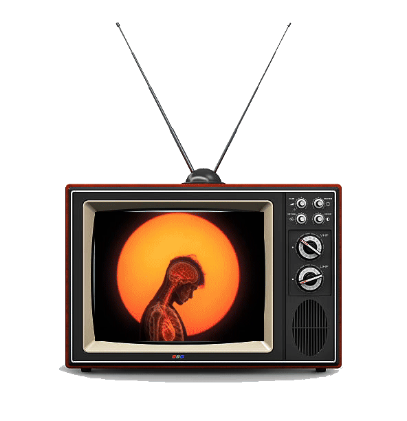

# TV Banner Guide

How to put a video inside an old TV image and use it as a GitHub README banner.

GitHub READMEs can't play an MP4 inside a custom frame, so the video and the TV image are combined into a single animated **GIF** using ffmpeg.

---

## Files you need (all in the same folder)

| File | What it is |
|---|---|
| `tv.png` | The old TV image |
| `ffmpeg.exe` | The ffmpeg tool (keep it out of git) |
| `imagination.mp4` | Your video |
| `make-banner.ps1` | The script below |

---

## 1. Create the script

Create a file named `make-banner.ps1` in the repo folder and paste this:

```powershell
param(
  [string]$video = "imagination.mp4",
  [string]$out = "tv_banner.gif"
)

.\ffmpeg.exe -y -loop 1 -i tv.png -i $video -filter_complex "[1:v]crop=ih*246/188:ih,scale=246:188[v];[0:v][v]overlay=138:308:shortest=1,fps=15,split[a][b];[a]palettegen=reserve_transparent=1[p];[b][p]paletteuse=alpha_threshold=128" -loop 0 $out

Write-Host "Done: $out"
```

---

## 2. Build the banner

Put your video in the same folder, open a terminal there, and run:

```powershell
powershell -ExecutionPolicy Bypass -File .\make-banner.ps1 your-video-name.mp4
```

Replace `your-video-name.mp4` with the name of your video file.

To use the default `imagination.mp4`:

```powershell
powershell -ExecutionPolicy Bypass -File .\make-banner.ps1
```

This creates (or overwrites) `tv_banner.gif`.

---

## 3. Add it to the README

```html
<div align="center">
  
</div>
```

The filename stays `tv_banner.gif`, so you don't need to edit the README again when you change videos.

---

## 4. Push to GitHub

```powershell
git add tv_banner.gif
git commit -m "Update banner"
git push
```

---

## 5. Keep big files out of git

Add this to `.gitignore`:

```
ffmpeg.exe
ffplay.exe
ffprobe.exe
*.mp4
```

If `ffmpeg.exe` was already tracked by git, run this once (the file is not deleted):

```powershell
git ls-files ffmpeg.exe
git rm --cached ffmpeg.exe
```

---

## Tweaks

**Screen position is off?** Edit these numbers in the script:

- `overlay=138:308` -> `X:Y` (top-left corner of the TV screen)
- `scale=246:188` and `crop=ih*246/188:ih` -> `W:H` (screen width and height)

**GIF too big (over 10 MB)?**

- Change `fps=15` to `fps=10`
- Use a shorter video

**Old-TV look (noise + dark edges)?** Change the first part of the filter to:

```
[1:v]crop=ih*246/188:ih,scale=246:188,noise=alls=10:allf=t,vignette=PI/4[v]
```

**Old GIF still showing on GitHub?** Hard refresh with `Ctrl + F5`.

**Check ffmpeg works:**

```powershell
.\ffmpeg.exe -version
```
