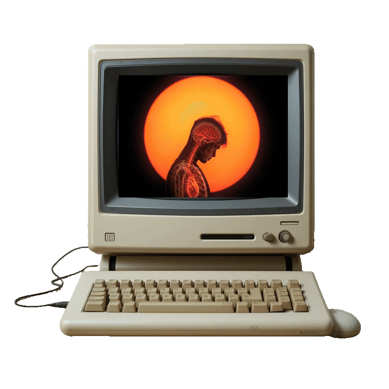

# Retro PC Banner Guide

How to put a video inside the retro computer image (`retro-pc.png`) and use it as a GitHub README banner.

GitHub READMEs can't play an MP4 inside a custom frame, so the video and the image are combined into a single animated **GIF** using ffmpeg.

This is the second banner style. For the old TV version, see `BANNER-GUIDE.md`.

---

## Files you need (all in the same folder)

| File | What it is |
|---|---|
| `retro-pc.png` | The retro computer image |
| `ffmpeg.exe` | The ffmpeg tool (keep it out of git) |
| `imagination.mp4` | Your video |
| `make-retro.ps1` | The script below |

---

## 1. Create the script

Create a file named `make-retro.ps1` in the repo folder and paste this:

```powershell
param(
  [string]$video = "imagination.mp4",
  [string]$frame = "retro-pc.png",
  [string]$out = "retro_banner.gif",
  [double]$left = 0.305,
  [double]$top = 0.194,
  [double]$width = 0.435,
  [double]$height = 0.314,
  [switch]$preview
)

Add-Type -AssemblyName System.Drawing
$img = [System.Drawing.Image]::FromFile((Resolve-Path $frame))
$fw = $img.Width
$fh = $img.Height
$img.Dispose()

$ox = [int]($fw * $left)
$oy = [int]($fh * $top)
$sw = [int]($fw * $width)
$sh = [int]($fh * $height)

$filter = "[1:v]crop=ih*${sw}/${sh}:ih,scale=${sw}:${sh}[v];[0:v][v]overlay=${ox}:${oy}:shortest=1"

if ($preview) {
  .\ffmpeg.exe -y -i $frame -i $video -filter_complex $filter -frames:v 1 preview.png
  Write-Host "Done: preview.png"
}
else {
  .\ffmpeg.exe -y -loop 1 -i $frame -i $video -filter_complex "$filter,scale=800:-1:flags=lanczos,fps=12,split[a][b];[a]palettegen=reserve_transparent=1[p];[b][p]paletteuse=alpha_threshold=128" -loop 0 $out
  Write-Host "Done: $out"
}
```

The script reads the image size itself and positions the video using percentages, so it works with any image size.

---

## 2. Make a preview first

Check the video position before building the full GIF:

```powershell
powershell -ExecutionPolicy Bypass -File .\make-retro.ps1 -preview
```

Open `preview.png` and check that the video sits inside the screen.

---

## 3. Fix the position (if needed)

All values are between 0 and 1:

```powershell
powershell -ExecutionPolicy Bypass -File .\make-retro.ps1 -preview -left 0.31 -top 0.20 -width 0.42 -height 0.30
```

| Option | Effect when increased |
|---|---|
| `-left` | Video moves right |
| `-top` | Video moves down |
| `-width` | Video gets wider |
| `-height` | Video gets taller |

Change the numbers, run the preview again, and repeat until it fits the screen.

---

## 4. Build the final GIF

```powershell
powershell -ExecutionPolicy Bypass -File .\make-retro.ps1
```

To use a different video:

```powershell
powershell -ExecutionPolicy Bypass -File .\make-retro.ps1 -video your-video-name.mp4
```

If you changed the position values in step 3, add them here too:

```powershell
powershell -ExecutionPolicy Bypass -File .\make-retro.ps1 -left 0.31 -top 0.20 -width 0.42 -height 0.30
```

This creates `retro_banner.gif`.

---

## 5. Add it to the README

```html
<div align="center">
  
</div>
```

Change `width` to make it bigger or smaller (`45%` small, `60%` medium, `80%` large).

---

## 6. Push to GitHub

```powershell
git add retro_banner.gif retro-pc.png make-retro.ps1 README.md
git commit -m "Add retro PC banner"
git push
```

---

## Keep big files out of git

Add this to `.gitignore`:

```
ffmpeg.exe
ffplay.exe
ffprobe.exe
*.mp4
preview.png
```

---

## Tweaks

**GIF too big (over 10 MB)?**

- Lower `fps=12` to `fps=10`
- Change `scale=800` to `scale=600`
- Use a shorter video

**Old GIF still showing on GitHub?** Hard refresh with `Ctrl + F5`.

**Script blocked by PowerShell?** Always run it with `-ExecutionPolicy Bypass` as shown above.
